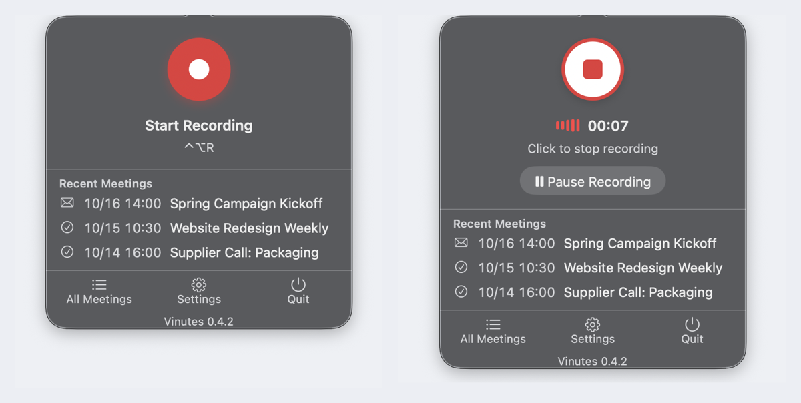
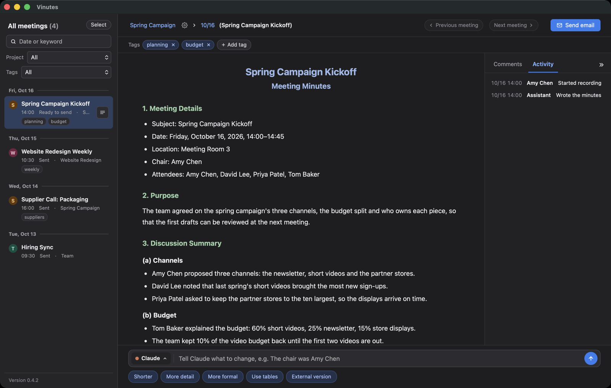
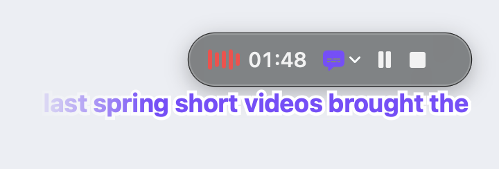

# Vinutes

Vinutes records your meetings on a Mac and turns them into formal, well-structured minutes. The minutes are published as a Google Doc your colleagues can edit and comment on, and the follow-up email goes out only when you press Send.

> **Status: early.** Vinutes runs on Macs with Apple silicon. The app speaks English and Traditional Chinese. 中文說明：[README.zh-TW.md](README.zh-TW.md)

## What it does

- **Records from the menu bar.** Start with one click or ⌃⌥R, pause and resume while the meeting goes on. In an online meeting it records the other side too, with Bluetooth earphones, wired headphones or the speakers (macOS 14.2 and later). While it records, 我 (Me) and 對方 (Others) each have their own bars, so you can see both sides coming in; Settings > Microphone picks which microphone to record.
- **Transcribes on your Mac.** Audio is turned into text locally with Whisper and is not uploaded. Most of it is transcribed while the meeting is still going, a few minutes at a time, so the transcript is ready about a minute after you press Stop. For Chinese meetings you can switch to Qwen3-ASR in the setup checklist (item 3, Change): it hears names and quiet speakers better and punctuates, at the cost of a 4 GB download.
- **Shows live captions.** CC on the floating bar shows what people are saying, under the bar, as they say it (macOS 26 and later). The captions are made on your Mac and are not written into the transcript.
- **Tells speakers apart** by their voices. In the People tab you pick who each voice is: the minutes and the email change to that name, and the next meeting recognises the voice. You can pick while the AI is rewriting the minutes; the name goes in once it is done.
- **Writes the minutes with the AI you already use:** Claude Code, Codex or Antigravity. Each one runs in a sandbox that can only read and write that meeting's folder.
- **Matches the recording to your Google Calendar** to fill in the title, time, place and attendees. A room booking that names its host and department in the event's note counts too, and the department's people, once confirmed under People, come back at its next meeting.
- **Publishes a Google Doc** and keeps it in sync: your colleagues' edits and comments show up in the app, and when you edit in the app only the paragraphs you changed are updated, so their comments stay where they were.
- **Learns from your corrections.** A misheard name you fix once goes into the project's brief (or your glossary, for a meeting without a project), and the next meeting gets it right.
- **Adds attachments to the minutes.** Add attachments, under the meeting's title, takes files, links and pictures, each with a note of its own. They are saved to Google Drive and listed in Attachments, the last section of the minutes, which every set of minutes has ("None" until something is attached).
- **Hands the AI something to read.** Files, links and pictures added with ＋ and the picture button beside the box under the minutes go to the AI with your sentence and stay out of the minutes: PDF, Word, Excel, PowerPoint and text files, or a web page's link.
- **Prepares the email** to the attendees: they are the recipients already, with addresses from the calendar invitation and the company directory, and typing a name offers people to add. The email says what the meeting was for and its highlights; once you have edited the minutes, both are written again from your edited minutes when you open the email. Its last line says which Vinutes version sent it. Nothing is sent until you press Send.
- **Files meetings by project.** Each meeting belongs to a project, whose name shows under the meeting's title in the list, after a folder on the project's own colour. The project name above a meeting moves it to another project or a new one.
- **Keeps a brief for each project.** In Project settings you list the project's people with what each one does, its terms and a few lines of background. The AI reads the briefs before it writes the minutes, so names and who does what come out right. A name the minutes have and the brief doesn't waits under To confirm; Looks right adds the person to the brief.
- **Reads the project's folder.** Choose the folder where a project's files are in Project settings, and the AI reads its earlier minutes, proposals and schedules when it writes the minutes, for background and to check names and dates. Word, Excel and PowerPoint files are read as text, from a copy: the files in the folder are never changed.
- **Scores each meeting's minutes.** The grey number at the end of the attachments row is how well the minutes were written; a click lists where points were lost and what would fix it next time. Until you send the mail, the score is the AI's check of the minutes against the transcript; when you send it, the score comes from your edits.
- **Shows what each month used.** Usage, in the meeting window's corner and in the menu-bar panel, shows by day or by project how many times the AI ran and its tokens, the Google requests, the emails sent, and how much disk the meetings and Vinutes itself take. Meetings recorded before Usage existed are filled in from their logs: runs and time, without tokens or Google requests.
- **Keeps the list tidy.** Archive the meetings you no longer need to see, or delete them: the recording, transcript and minutes go to the Trash, and the Google Doc to Google Drive's trash. Select several at once, or right-click one.

## What it looks like

**The menu bar.** Click the calligraphic V at the top of the screen to open this panel. The red button starts a recording; while it runs, the same button stops it. The last three meetings open from here too.



**The meeting window.** Every meeting and its minutes are here. To change the minutes, tell Claude what to change in the box at the bottom.



**The floating bar.** While recording, a small bar shows how long the recording has run, with Pause and Stop. Press CC to show live captions under it (macOS 26 and later).



The meetings in these pictures are made up.

## Languages

**The app** follows your Mac's language: Traditional Chinese if Chinese comes first in System Settings > Language & Region, English otherwise. Pick English or Traditional Chinese under Settings > App Language in the menu bar, or at the top of the setup checklist; Same as Mac goes back to following the Mac.

**The meeting.** Vinutes listens to the start, middle and end of each recording and decides which language was spoken. If your meetings are always in one language, pick it under Settings > Meeting Language and Vinutes stops guessing.

**The minutes** are written in the meeting's language when it is English or Chinese. A meeting in any other language gets its minutes in the app's language, and the transcript keeps the original words.

How well each language is heard, measured on real speech (24 read sentences per language, October 2026):

| | Languages | Transcript errors per 100 words (characters for Chinese, Japanese, Korean, Thai) |
|---|---|---|
| Works well | English, Chinese, Japanese, Korean, Spanish, French, German | 3–7 |
| Usable, check the minutes more closely | Vietnamese, Indonesian, Filipino | 10–11 |
| Usable, more errors | Thai, Cantonese (treated as a Chinese meeting) | about 18 |

Names, numbers and dates are what most often come out wrong. In a meeting held in a language your team doesn't read, check them in the minutes before you send.

## Requirements

- A Mac with Apple silicon (M1 or newer)
- Xcode Command Line Tools (`xcode-select --install`) and Python 3.10 or newer
- An account for one of the AIs that write the minutes: Claude Pro or higher (Claude Code), ChatGPT Plus or higher (Codex), or a Google account (Antigravity). Nothing to install beforehand: the setup checklist installs the AI you pick and signs it in.
- For Google Docs, Gmail and Calendar: a Google account and a one-time Google Cloud setup. The app walks you through it step by step; it takes about 15 minutes.

## Install

```bash
git clone https://github.com/miou1107/Vinutes ~/Vinutes
~/Vinutes/recorder/install.sh
```

The first run downloads the speech model (about 1.6 GB), so it can take a while. When it finishes, a calligraphic V appears in the menu bar. Open the meeting window and go through the setup checklist once.

## Use your meetings in Claude Code and other AI tools

Vinutes is also an MCP server. Installing or updating Vinutes connects it to the AI tools on your Mac: Claude Code, Codex, Gemini CLI, Claude's desktop app, Antigravity and Cursor (restart the last three once). To connect a tool installed later, run:

```bash
~/.config/vin-meeting-minutes-zh/venv/bin/python ~/Vinutes/scripts/connect_agents.py
```

Then, in any folder, ask Claude Code (or any of them) "what did last week's project meeting decide?" and it searches your minutes and transcripts and answers with the meeting's date and title. When you ask it to, it can also name a speaker, add a paragraph to Attachments, change words in the minutes, and set tags or the project; the Google Doc follows, and the meeting's history says Claude Code made the change. Deleting a meeting and sending mail stay in Vinutes.

## Update

When a newer version is on GitHub, the meeting window shows an update button. Settings > Check for Updates in the menu bar looks at once. You can also update by hand:

```bash
git -C ~/Vinutes pull && ~/Vinutes/recorder/install.sh
```

After installing or updating, Vinutes downloads one small file from GitHub; the number of downloads shows roughly how many Macs use it. Nothing about your Mac or you is sent. To be left out, run this once, and later installs and updates skip the download:

```bash
touch ~/.config/vin-meeting-minutes-zh/no-count
```

## Where your data lives

Your settings, Google sign-in, glossary, project briefs, recordings and usage record are kept in `~/.config/vin-meeting-minutes-zh/`, never in this folder, so updating or reinstalling Vinutes leaves them alone. The folder is shared with the [vin-meeting-minutes-zh](https://github.com/miou1107/vin-meeting-minutes-zh) skill, so you sign in to Google only once for both.

## What is in this repository

| Path | What it is |
|---|---|
| `recorder/` | The Mac app (Swift) and the meeting window (HTML, CSS, JavaScript), plus `install.sh` |
| `scripts/` | Python: transcription, speakers, writing the minutes, Google Docs sync, Gmail and Calendar, the setup checklist |
| `SKILL.md`, `references/` | How the minutes are written: `SKILL.md` for Chinese minutes (Taiwan usage), `references/minutes-guide-en.md` for English ones; the AI reads the right one for every meeting |
| `tests/` | `python3 -m unittest discover -s tests` |

## Only have a transcript?

If you just want an AI to turn a transcript into minutes, without recording, use the [vin-meeting-minutes-zh](https://github.com/miou1107/vin-meeting-minutes-zh) skill instead.
